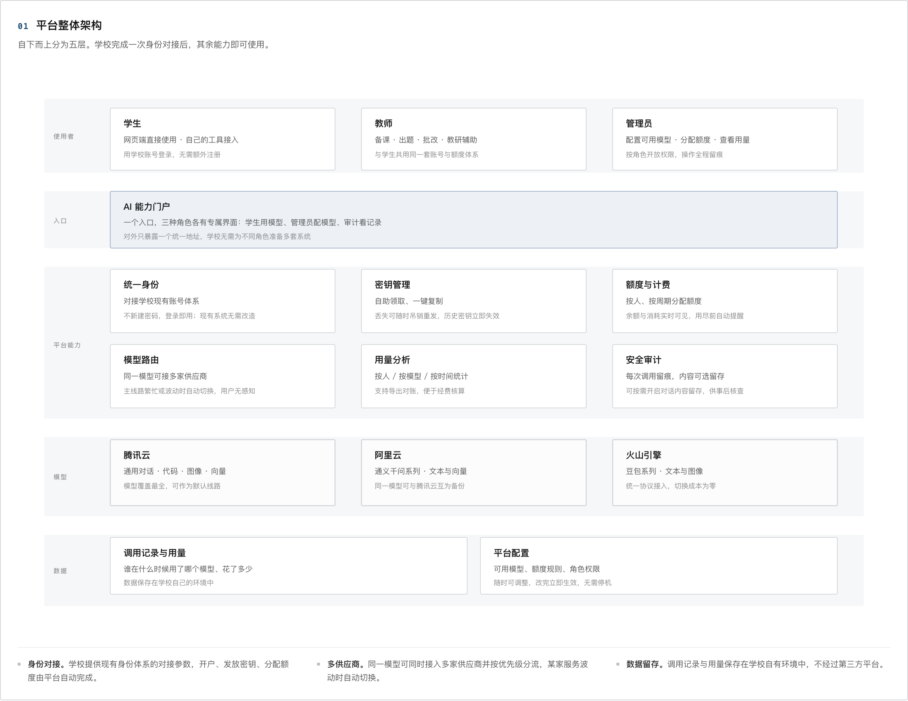

# 学校 AI 模型门户（统一采买站）

学校 AI 模型门户。学生使用学校账号登录后自助领取 API Key，查看可用模型、价格与用量，并可在浏览器中直接调试；管理员在后台完成模型供应商接入、登录方式配置、额度策略与运营活动管理。

Next.js 15（App Router）+ TypeScript + Tailwind + PostgreSQL。代码仓库：`campus-tokenhub-assign`。

> **第一次部署？** 把仓库交给 AI，说一句「按 docs/QUICKSTART.md 帮我完成本地部署和调试」。该文件是给 AI 的执行指引（安装、选型、写配置、验收），命令与排障参考 [RUNBOOK-local.md](docs/RUNBOOK-local.md)。



> 上图：平台整体架构（自下而上五层）。完整说明另含 3 张流程图：[架构与使用流程（HTML）](docs/tokenhub-architecture.html) ｜ [整页长图](docs/tokenhub-architecture.png)

---

## 目录

- [功能概览](#功能概览)
- [系统架构](#系统架构)
- [部署要求](#部署要求)
- [部署步骤](#部署步骤)
- [首次配置](#首次配置)
- [配置参考](#配置参考)
- [模型与供应商](#模型与供应商)
- [管理后台](#管理后台)
- [日常运维](#日常运维)
- [安全清单](#安全清单)
- [已知限制](#已知限制)
- [本地开发](#本地开发)
- [相关文档](#相关文档)

---

## 功能概览

### 学生与教师

| 能力 | 说明 |
| --- | --- |
| 统一身份登录 | 对接学校 OAuth2 或 CAS，无需额外账号 |
| 自助领取密钥 | 首次登录自动开户，按学校策略分配额度与限流 |
| 模型集市 | 模型能力、上下文长度、模态与价格一目了然 |
| 用量看板 | 调用趋势、模型分布、调用日志，支持导出 CSV |
| 在线调试 | 浏览器内直接发起请求，可复制 cURL / Node / Python 代码 |
| 运营活动 | 领取学校配置的算力活动 |

### 管理员

| 能力 | 说明 |
| --- | --- |
| 初始化向导 | 图形化接入腾讯云 TokenHub、阿里云百炼、火山方舟 |
| 品牌配置 | 学校名称、登录页文案、主题色、Logo |
| 额度与限流 | 开户默认额度、周期、RPM / TPM |
| 登录认证 | OAuth2 / CAS 参数、字段映射、管理员角色同步、登录限制，界面维护无需重启 |
| 管理员名单 | 全局管理员统一维护，支持搜索与批量添加 |
| 运营活动 | 活动标题、点数、周期与上下线 |
| 网关后台 | 模型、路由、定价与全站用量的细粒度管理 |

门户**不承载推理流量**：学生持 Key 直连推理网关，门户负责身份、发号、看板与配置。

---

## 系统架构

### 组件

| 组件 | 容器 | 职责 |
| --- | --- | --- |
| 统一入口 | `nginx` | 唯一对外端口，按路径分流 |
| 门户应用 | `portal` | 学生端与管理员端页面、接口 |
| 推理网关 | `gateway-proxy` | 模型请求转发，流式输出 |
| 网关管理台 | `gateway-admin` | 供应商、模型、路由、额度、调用日志 |
| 数据库 | `postgres` | 网关数据与门户数据同库、不同 schema |
| 表结构迁移 | `migrate` | 一次性执行，完成后退出 |
| 登录参数种子 | `portal-seed` | 一次性写入默认登录参数，完成后退出 |

### 请求路径

```
浏览器
  │  /tokenhub/portal/**   页面与接口
  │  /tokenhub/v1/**       携带 API Key 的模型调用
  ▼
反向代理 / CLB（仅一级转发，不改写路径）
  ▼
nginx :8088
  ├─ /tokenhub/admin/**   → gateway-admin:8789   （剥前缀）
  ├─ /tokenhub/portal/**  → portal:3000          （原样透传）
  └─ /tokenhub/**         → gateway-proxy:8787   （剥前缀）
```

门户使用 Next.js 的 `basePath` 自带前缀，因此反向代理原样透传；管理台与网关按根路径运行，由 nginx 剥掉前缀。

### 数据存储

与网关共用同一个 PostgreSQL 实例，按 schema 隔离：

| schema | 归属 | 主要表 |
| --- | --- | --- |
| `portal_shared` | 两站共用 | `admins`、`app_config`、`login_config`、`settings`、`session_revocations`、`config_audit` |
| `portal_assign` | 本应用 | `activity_configs` |
| `portal_member` | 成员自购站（可选部署） | `member_applications` |
| `octafuse_gateway` | 推理网关 | 用户、密钥、模型、路由、调用日志 |

门户只持久化三类数据：运营活动、管理员名单、运行期配置。身份、额度、密钥与调用日志的权威来源均为网关，门户实时读取，不重复存储。

表结构在应用首次启动时自动创建。历史数据迁移见 [`deploy/migrate/README.md`](deploy/migrate/README.md)。

---

## 部署要求

### 服务器

| 项 | 生产要求 | 说明 |
| --- | --- | --- |
| CPU / 内存 | **16 核 / 32 GB** 起 | 单机部署全套组件 |
| 磁盘 | **1 TB SSD** 起 | 调用日志与正文留存为主要增长项 |
| 操作系统 | Ubuntu 22.04 / Debian 12（x86_64） | 需支持 Docker |
| Docker | 24 及以上，含 Compose v2 | 使用 `docker compose` 命令 |
| 网络 | 可访问模型供应商 API | 出网受限会导致调用失败 |

内存分配、多副本、磁盘规划与数据库参数建议见[使用教程](docs/campus-tokenhub-assign-使用教程.md)第 1.1 节。

### 端口

| 端口 | 服务 | 绑定 | 用途 |
| --- | --- | --- | --- |
| 8088 | nginx | `0.0.0.0` | 唯一对外入口 |
| 3000 | portal | `127.0.0.1` | 排障直连 |
| 8790 | gateway-proxy | `127.0.0.1` | 排障直连；浏览器调试台落点 |
| 8789 | gateway-admin | `127.0.0.1` | 排障直连 |
| 5433 | postgres | `127.0.0.1` | 宿主机数据库客户端 |

除 8088 外均只监听回环地址，不需要对外暴露。

### 域名与证书

生产环境需要一个可公网访问的域名，并在反向代理或 CLB 上终止 TLS。门户默认挂载在 `/tokenhub/portal`，管理台在 `/tokenhub/admin`，模型调用在 `/tokenhub/v1`。若门户独占域名根路径，可将 `PORTAL_BASE_PATH` 留空。

---

## 部署步骤

### 1. 获取代码

```bash
git clone <仓库地址> campus-tokenhub-assign
cd campus-tokenhub-assign
```

确认当前目录直接包含 `package.json`，不要出现同名嵌套目录。

推理网关源码随仓库提供（`local-stack/octafuse-gateway`），首次 `docker compose up --build` 会一并构建三个网关镜像，无需额外拉取。若改为对接外部已有网关，修改 `.env` 中的 `OCTAFUSE_ADMIN_BASE` 与 `OCTAFUSE_PROXY_BASE`，并删除 compose 中的网关服务段。

### 2. 生成配置

```bash
cp .env.example .env
```

四个值必须重新生成：

```bash
openssl rand -base64 48   # SESSION_SECRET
openssl rand -hex 24      # POSTGRES_PASSWORD
openssl rand -hex 12      # PORTAL_ADMIN_PASSWORD（人登录用的部署管理员口令）
openssl rand -base64 18   # OCTAFUSE_ADMIN_PASSWORD（门户调网关 API 的服务账号，机器对机器）
```

必须写在 `.env` 的配置（基础设施与启动必需）：

```bash
# 会话与数据库
SESSION_SECRET=<48 字符随机串>
POSTGRES_PASSWORD=<24 位十六进制>

# 网关
OCTAFUSE_ADMIN_USERNAME=admin
OCTAFUSE_ADMIN_PASSWORD=<强口令>
OCTAFUSE_EXTERNAL_SYSTEM=campus-tokenhub

# 对外地址（均为浏览器访问地址，含前缀）
PUBLIC_BASE_URL=https://ai.example.edu.cn/tokenhub/portal
PORTAL_BASE_PATH=/tokenhub/portal
NEXT_PUBLIC_PROXY_BASE=https://ai.example.edu.cn/tokenhub
ADMIN_UI_PUBLIC_PATH=/tokenhub/admin
ADMIN_PUBLIC_BASE_URL=https://ai.example.edu.cn/tokenhub/admin
COOKIE_SECURE=true
ADMIN_COOKIE_SECURE=1
NGINX_PUBLIC_PROTO=https
```

`PORTAL_BASE_PATH` 与 `ADMIN_UI_PUBLIC_PATH` 为**构建期参数**，修改后必须重新构建镜像。

学校名称、开户额度、限流、SSO 参数等运行期配置**不通过环境变量配置**，全部在「设置」页面维护，保存即生效。写在 `.env` 里不会生效，启动日志会提示哪些变量已被忽略。

唯一保留的环境变量通道是引导账号，用于首次部署进入设置页：

```bash
PORTAL_ADMIN_USERNAME=ops-admin
PORTAL_ADMIN_PASSWORD=<12 字符以上随机串>
PORTAL_ADMIN_LOGIN=auto
```

这组账号是**唯一的部署管理员口令**，SSO 配齐后**不会自动关闭**——请确认学校账号能登录后，再把 `PORTAL_ADMIN_LOGIN` 置 `off`。也可以随时在「设置 → 登录认证 → 部署管理员」里维护。

共享配置是唯一权威：**首次启动**若库里还没有口令，会把 `.env` 这两项加密写进 `portal_shared.login_config`（与设置页同一列），之后改 `.env` 不再生效（启动日志会提示被忽略）。同库双站部署因此读同一行、天然一致；分栈部署（两套 compose、两个库）没有共享行，必须把两处写成同一个值。

> `OCTAFUSE_ADMIN_USERNAME` / `OCTAFUSE_ADMIN_PASSWORD` 不是这套登录口令：它是门户调用网关 admin API 的服务账号（Basic 登录 `/api/auth/login`）。管理台（`ADMIN_AUTH_MODE=portal`）的人工登录走的就是上面的 portal 会话，没有第三个口令。

### 3. 启动

```bash
docker compose up -d --build
docker compose ps -a
```

期望状态：`postgres`、`gateway-proxy`、`gateway-admin`、`portal`、`nginx` 为 `healthy`；`migrate` 与 `portal-seed` 为 `Exited (0)`。`-a` 用于显示这两个一次性容器。

### 4. 验收

```bash
curl -s http://127.0.0.1:8088/nginx-health
curl -s http://127.0.0.1:8088/tokenhub/portal/api/health
# {"status":"ok","gateway":true}
```

`gateway` 为 `true` 表示门户已连通网关管理端。若为 `false`，先检查 `gateway-admin` 是否就绪，再看 `docker compose logs portal`。

### 5. 接入反向代理

门户前面需要一层反向代理或负载均衡，仅做一级转发，**不改写路径**：

| 规则 | 转发目标 | nginx 内部分流 |
| --- | --- | --- |
| `/tokenhub/*` | 本机 `:8088` | `/tokenhub/admin/**` → `gateway-admin:8789`，剥前缀 |
| | | `/tokenhub/portal/**` → `portal:3000`，原样透传 |
| | | 其余 `/tokenhub/**` → `gateway-proxy:8787`，剥前缀 |

反向代理需保证 `X-Forwarded-Proto: https`，并由它终止 TLS。学生浏览器直连的 `NEXT_PUBLIC_PROXY_BASE` 必须是 `https://` 地址，否则 API Key 会以明文传输。

国内常见做法是将 `/tokenhub/` 前缀整体交给 CLB，CLB 转发到本机 `8088`，路径细分由 nginx 完成，CLB 不做改写。

---

## 首次配置

### 登录方式

门户支持标准 OAuth2 授权码与标准 CAS 两种协议，参数保存在数据库，可在界面维护，修改后无需重启。

对接前需要准备：

1. 在 IdP 或 CAS Server 注册应用，取得 `client_id` / `client_secret`（CAS 无需密钥）；
2. 将回调地址登记到白名单：`https://<门户域名>/tokenhub/portal/api/auth/callback`。

回调地址由 `PUBLIC_BASE_URL` 自动推导，更换域名时只需更新白名单，不需要改配置。

### 配置登录

所有登录参数都保存在数据库，只能在「设置 → 登录认证」维护，修改后即时生效。

**已有 SSO 参数。** 在 `deploy/init/010-login-config.sql` 顶部的「学校对接参数」里填 provider（`oauth2` / `cas`）、端点与 Client ID，`portal-seed` 会在建表后自动写入，部署完成后只需在「设置 → 登录认证」补一次 Client Secret。也可以全部留空，部署后手工在设置页填写。

**尚无 SSO 参数。** 用引导账号进入设置页完成对接：

```bash
PORTAL_ADMIN_USERNAME=ops-admin
PORTAL_ADMIN_PASSWORD=<12 字符以上随机串>
PORTAL_ADMIN_LOGIN=auto
docker compose up -d portal
```

1. 打开 `/login`，页面显示账号密码入口；
2. 登录后进入 `/settings` → 「登录认证」，填写 OAuth2 或 CAS 参数并保存；
3. 保存成功后当前会话立即失效并跳回登录页，页面只剩学校账号登录入口，表示对接完成；
4. 用学校账号登录验证，随后将 `PORTAL_ADMIN_LOGIN` 改为 `off` 并清空口令。

判定标准是当前协议的必填项是否全部非空（OAuth2 五项 / CAS 两项）。只填一部分仍视为未对接，引导入口保持可用，避免部署被锁死。设置页是整表提交，五项需一次填全才能保存。

> 从更早版本升级时，`.env` 里的 `AUTH_PROVIDER` / `OAUTH2_*` / `CAS_*` 不再生效，需要按上述步骤在设置页重新填写一次。`portal-seed` 会补齐端点与映射，Client Secret 必须手动填。


### 初始化向导

首次部署尚无初始化负责人时，第一个登录的账号会被引导至 `/setup` 并成为初始化负责人，此后该入口仅对管理员可见。

1. 选择供应商：腾讯云 TokenHub、阿里云百炼、火山方舟；
2. 在对应控制台创建 API Key（页面提供直达链接）；
3. 填写后点击「检测 Key」，门户会校验上游可用性；
4. 按模型类型勾选需要开放的模型；
5. 点击「开始初始化」，自动创建供应商、模型与路由。

初始化可重复执行：已完成的条目自动跳过，未勾选的模型不会被删除，支持补选模型或更换 Key。模板不包含任何 API Key，学校凭证只保存在网关数据库中。

### 管理员名单

全局管理员依据以下顺序判定，任一命中即可：

1. 引导期账号密码登录的本地身份；
2. `portal_shared.admins` 管理员名单（设置页维护）；
3. 名单为空时，首个合法登录者自动认领。

**上线前先把名单配好。** 名单为空时任何完成首次登录的人都可能被认领为管理员，这是全新部署的破局设计，不适合长期空置。名单为空且首个登录者身份非 `school_id:user_id` 格式时，可在能访问数据库的机器上执行（需已配置 `PORTAL_DATABASE_URL`）：

```bash
npm run bootstrap-admin -- "school_001:100234567"
```

---

## 配置参考

配置分三类，生效方式不同：

| 类别 | 范围 | 怎么改 |
| --- | --- | --- |
| 部署参数 | 数据库连接、网关地址、构建期前缀、端口、会话密钥 | **只能改环境变量**，部分需重建镜像 |
| 运行期配置 | 学校名称、开户额度、限流、SSO 参数（含 Client Secret） | **只在「设置」页面维护**，保存即生效 |
| 引导账号 | `PORTAL_ADMIN_USERNAME` / `_PASSWORD` / `_LOGIN` | 环境变量或设置页均可，数据库有值时以数据库为准 |

运行期配置**不读取环境变量**。写在 `.env` 里的同名变量会被忽略，启动日志会列出具体是哪些，便于清理旧配置。

完整注释见仓库根目录 `.env.example`。

### 必填（仅环境变量）

| 变量 | 说明 |
| --- | --- |
| `SESSION_SECRET` | 32 字符以上随机串，用于签发会话 |
| `POSTGRES_PASSWORD` | 数据库口令，建议只用十六进制字符 |
| `OCTAFUSE_ADMIN_USERNAME` / `_PASSWORD` | 网关管理台账号，门户用于服务端调用 |
| `OCTAFUSE_EXTERNAL_SYSTEM` | 外部身份命名空间，如 `campus-tokenhub`，无默认值 |
| `PUBLIC_BASE_URL` | 对外访问根地址，含路径前缀 |

### 地址与会话（仅环境变量）

| 变量 | 默认 | 说明 |
| --- | --- | --- |
| `PORTAL_BASE_PATH` | 空 | 门户前缀，构建期生效 |
| `ADMIN_UI_PUBLIC_PATH` | 空 | 管理台前缀，构建期生效 |
| `ADMIN_PUBLIC_BASE_URL` | 空 | 侧边栏跳转管理台的公网地址 |
| `NEXT_PUBLIC_PROXY_BASE` | 空 | 学生浏览器直连网关的地址 |
| `COOKIE_SECURE` | `false` | 启用 TLS 后必须为 `true` |
| `ADMIN_COOKIE_SECURE` | 空 | 管理台 Cookie 是否带 Secure，TLS 后置 `1` |
| `SESSION_TTL_HOURS` | `8` | 会话有效期 |
| `PORTAL_COOKIE_PATH` / `_DOMAIN` | 空 | 会话 Cookie 作用域，单站部署留空 |

### 登录认证

| 变量 | 配置方式 | 说明 |
| --- | --- | --- |
| `AUTH_PROVIDER` | 设置页 | `oauth2`（默认）或 `cas`，由设置页选择 |
| `OAUTH2_AUTHORIZATION_ENDPOINT` / `_TOKEN_ENDPOINT` / `_USERINFO_ENDPOINT` | 设置页 | OAuth2 三个端点 |
| `OAUTH2_CLIENT_ID` | 设置页 | 应用标识 |
| `OAUTH2_CLIENT_SECRET` | 设置页（加密） | 可留空，部署后填一次即可 |
| `OAUTH2_SCOPES` | 设置页 | 授权范围，默认 `openid profile email` |
| `OAUTH2_TOKEN_AUTH_METHOD` | 设置页 | `client_secret_basic` 或 `client_secret_post` |
| `OAUTH2_USERINFO_TOKEN_CARRIER` | 设置页 | `header` 或 `query` |
| `CAS_LOGIN_URL` / `CAS_TICKET_VALIDATE_URL` | 设置页 | CAS 认证地址与验票地址 |
| `PORTAL_ADMIN_USERNAME` / `_LOGIN` | 设置页 | 引导期账号，`auto` / `on` / `off` |
| `PORTAL_ADMIN_PASSWORD` | 设置页（加密） | 引导期口令，12 字符以上 |
| `CONFIG_ENCRYPTION_KEY` | 仅环境变量 | 加密配置项密钥；留空则从 `SESSION_SECRET` 派生 |

登录参数未配齐时门户仍可启动，缺项会在设置页与启动日志中提示；只有协议值非法才会拒绝启动。

### 额度与限流（设置页可配）

| 变量 | 默认 | 说明 |
| --- | --- | --- |
| `DEFAULT_BUDGET_MAX` | `100` | 开户默认额度 |
| `DEFAULT_BUDGET_PERIOD` | `monthly` | `daily` / `monthly` / `none` |
| `DEFAULT_RATE_LIMIT_RPM` | 不限 | 用户级每分钟请求上限，`0` 表示拒绝 |
| `DEFAULT_RATE_LIMIT_TPM` | 不限 | 用户级每分钟 token 上限 |

以上仅在网关创建新用户时写入，已存在用户不受影响。

### 网关与正文留存（仅环境变量）

| 变量 | 默认 | 说明 |
| --- | --- | --- |
| `OCTAFUSE_ADMIN_BASE` / `_PROXY_BASE` | 服务名 | 容器内使用 `gateway-admin:8789` / `gateway-proxy:8787` |
| `OCTAFUSE_GATEWAY_DIR` | `./local-stack/octafuse-gateway` | 网关源码路径，构建期使用 |
| `REQUEST_CONTENT_CAPTURE` | `on` | 正文留存总开关 |
| `REQUEST_CONTENT_MAX_CHARS` | `65536` | 单侧正文入库上限（字符） |
| `REQUEST_CONTENT_RETENTION_DAYS` | `90` | 正文保留天数，按自然月整月清理 |
| `REQUEST_CONTENT_BATCH_SIZE` / `_FLUSH_MS` | `50` / `500` | 批量写入条数与间隔 |
| `REQUEST_CONTENT_MAINTENANCE` | `on` | 分区维护任务开关 |
| `NGINX_HOST_PORT` / `NGINX_PUBLIC_PROTO` | `8088` / `https` | 入口端口与后端协议 |

正文留存开启后，调用详情可查看当次请求与响应内容。该能力只对部署之后发生的调用生效，历史记录不会补写。

> 注意：正文分区会按保留天数自动清理，但调用日志明细表 `api_key_request_logs` 没有自动清理策略，需要纳入定期维护。1 万学生规模的容量估算与清理方式见[使用教程](docs/campus-tokenhub-assign-使用教程.md)第 1.1.4 节。

---

## 模型与供应商

### 支持范围

三家供应商均采用 OpenAI 兼容协议，门户负责创建供应商、模型与路由：

| 供应商 | Base URL | Key 控制台 | 预置模型 |
| --- | --- | --- | --- |
| 腾讯云 TokenHub | `https://tokenhub.tencentmaas.com/v1` | 腾讯云控制台 → TokenHub → API Key | 22 个（文本 / 图像 / 向量） |
| 阿里云百炼 | `https://dashscope.aliyuncs.com/compatible-mode/v1` | 百炼控制台 → API Key | 11 个（9 文本 + 2 向量） |
| 火山方舟 | `https://ark.cn-beijing.volces.com/api/v3` | 方舟控制台 → API Key | 11 个（8 文本 + 3 图像） |

模型清单按"旗舰 / 均衡 / 高性价比各留一档、同家族只留最新一代"的原则预置。清单外模型仍可在网关管理台手动添加。

限制说明：

- 阿里云百炼暂不支持图像生成：其文生图接口与 OpenAI `images/generations` 不兼容。
- 火山方舟暂不支持视频与向量：相关接口的请求与响应格式与 OpenAI 协议不一致。
- 按秒或按积分计费的模型（视频、3D、音乐、语音）在模型集市中仅展示，不支持通过本门户导入。

### 多供应商同款模型

同时接入多家供应商时，同名模型共用一个网关模型 ID，落在同一路由池，按权重分流：

| 网关模型 ID | 腾讯云 | 阿里云 | 火山方舟 | 默认权重 |
| --- | --- | --- | --- | --- |
| `deepseek-v4.1-flash-1017` | 同名 | 同名 | `deepseek-v4-1-flash-261017` | 8 : 1 : 1 |
| `kimi-k3.1-pro` | 同名 | 同名 | `kimi-k3-1-pro-261024` | 8 : 1 : 1 |
| `glm-5.3` | 同名 | 同名 | — | 8 : 1 |
| `glm-5.3-flash` | 同名 | — | `glm-5-3-flash-260828` | 8 : 1 |

默认腾讯云权重为 8，其余各 1，即主线路承担约八成流量。需要调整时，在网关管理台修改 `model_routes.weight`，或将模型的 `route_policy.strategy` 改为 `weight_priority`（高权重优先）或 `hash_affinity`（缓存亲和）。

### 价格数据

模型参数与价格来自供应商官方模型列表与价格页，随版本维护，初始化时自动带入，无需在页面手工填写。官方调价或模型上下架后，更新模型目录并重新执行初始化即可。

---

## 管理后台

管理后台复用门户会话，无需单独账号密码。浏览器访问 `/tokenhub/admin` 时，门户签发的 `portal_session` 会一并提交，管理台验签后放行。

- **访问权限**：`portal_shared.admins` 名单内的用户。登录门户时门户会向会话写入管理员声明，管理台只认该声明。
- **白名单为空**：无人可登录管理台，请先配置白名单。
- **退出**：配置 `PORTAL_LOGOUT_URL` 后，退出管理台会同时清除门户会话。
- **模式切换**：`ADMIN_AUTH_MODE` 可设为 `portal`（默认，仅认门户会话）、`password`（回到账号密码）、`both`。需要临时切换时修改这一项并重启管理台即可，无需更换版本。

---

## 日常运维

### 健康检查

| 检查项 | 地址 | 期望 |
| --- | --- | --- |
| 入口 | `http://127.0.0.1:8088/nginx-health` | `ok` |
| 门户 | `http://127.0.0.1:8088/tokenhub/portal/api/health` | `{"status":"ok","gateway":true}` |
| 网关代理 | `http://127.0.0.1:8790/health` | 200 |
| 数据库 | `pg_isready` | accepting connections |

容器自带健康检查，`docker compose ps` 可直接查看状态。外部监控建议只探测入口与门户健康检查两个地址，并在 `gateway` 为 `false` 时告警——这表示门户可用但网关异常。

### 日志与审计

应用日志与审计记录均以单行 JSON 输出到标准输出：

```bash
docker logs -f campus-tokenhub | jq -c 'select(.event)'
```

| 事件 | 含义 |
| --- | --- |
| `auth.login` / `auth.login.fail` | 登录成功 / 失败 |
| `provision.success` / `provision.fail` | 开户结果 |
| `key.create` / `key.revoke` | 密钥创建 / 吊销 |

密钥、口令与会话密钥在日志中均被脱敏。日志可直接接入 Loki、CLS 等采集系统。

### 备份

数据全部存放于 PostgreSQL，建议使用逻辑备份：

```bash
mkdir -p /data/backup
docker compose exec -T postgres pg_dump -U octafuse -d octafuse \
  -Fc -Z 9 --no-owner --no-acl > /data/backup/backup-$(date +%Y%m%d).dump
```

备份文件需与 `.env` 分开存放，后者包含密钥。建议保留 7 份日备与 4 份周备，并定期做恢复演练。备份目录不要放在容器卷内，并预留与数据库同等大小的空间。

### 升级

```bash
git pull
docker compose up -d --build
docker compose ps -a          # migrate 必须为 Exited (0)
```

升级前请先备份数据库。若本次升级涉及构建期参数（`PORTAL_BASE_PATH`、`ADMIN_UI_PUBLIC_PATH`），`--build` 必须保留：镜像内的前缀与运行期不一致时，管理台会拒绝启动。重建应用容器后，如入口出现 404，重启 nginx：

```bash
docker compose restart nginx
```

原因是 nginx 在启动时解析上游地址，应用容器重建后 IP 变化需要重新解析。

### 运维手册

故障排查、容量规划、并发评估、多机部署等专题见[使用教程](docs/campus-tokenhub-assign-使用教程.md)第 1 章与第 3 章。

---

## 安全清单

上线前逐项确认：

| 检查项 | 要求 |
| --- | --- |
| `SESSION_SECRET` | 生产环境重新生成，不复用测试配置 |
| `PUBLIC_BASE_URL` | 配置为实际 `https://` 域名；留空会回退到请求 Host 头 |
| `COOKIE_SECURE` | 启用 TLS 后为 `true` |
| `NEXT_PUBLIC_PROXY_BASE` | 必须为 `https://` 公网地址，该地址由浏览器携带 API Key 直连 |
| 网关口令 | 使用强口令，不使用示例值 |
| 端口暴露 | 仅对外暴露 8088，其余服务保持回环绑定 |
| 引导账号 | SSO 对接完成后置 `PORTAL_ADMIN_LOGIN=off` 并清空口令 |
| 管理员名单 | 上线前在「设置 → 管理员」配好，避免依赖首登自动认领 |
| 反向代理 | 由代理终止 TLS，覆写而非追加 `X-Forwarded-For`，并在代理层按 IP 限流 |

---

## 已知限制

- **在线调试依赖网关 CORS**。网关收紧跨域策略后，调试台的"发送请求"会失效，页面仍可复制 cURL 在本地执行。
- **不提供模型级访问控制**。网关没有"用户 → 模型"授权，防滥用依赖每人独立的额度。
- **门户不承载推理流量**。学生持 Key 直连网关，调试台的请求也由浏览器直接发出。
- **页面价格为估算**。按目录档位、时段倍率与路由折扣实时计算，用于参考，不作为账单依据。
- **管理员能力部分在网关侧**。修改额度、停用账号、查看全站用量等操作在网关管理台完成，门户不重复实现。

---

## 本地开发

```bash
npm ci
cp .env.example .env        # 至少配置 SESSION_SECRET 与网关账号
npm run dev:local           # 切换本地环境并启动，http://localhost:3000/tokenhub/portal
```

网关依赖可单独用容器启动，门户在宿主机热更新：

```bash
docker compose up -d postgres migrate gateway-proxy gateway-admin
```

### 环境切换

| 命令 | 作用 |
| --- | --- |
| `npm run env:local` | 切换本地地址，生成 `.env.local` 与 compose 覆盖文件 |
| `npm run env:lan` | 切换为局域网地址，自动探测内网 IP |
| `npm run env:current` | 查看当前生效环境 |

局域网模式下 `PUBLIC_BASE_URL` 会变为内网地址，该地址同样需要登记到 IdP 白名单。

### 质量门禁

```bash
npm run typecheck        # 类型检查
npm run lint             # 代码规范
npm test                 # 单元测试
npm run check:isolation  # 跨侧引用检查
npm run check:shared-ddl # 共享层 DDL 一致性
npm run build            # 生产构建
```

### 目录结构

```
src/app/          页面与接口（App Router）
src/components/   按页面组织的组件
src/lib/auth/     会话与 SSO 适配
src/lib/config/   配置字段声明与读写
src/lib/db/       表结构与连接
src/lib/gateway/  网关客户端
src/lib/onboarding/ 初始化向导与模型目录
```

二次开发的完整流程、常见改动示例与数据契约见[使用教程](docs/campus-tokenhub-assign-使用教程.md)第 4 章。

---

## 相关文档

| 文档 | 内容 |
| --- | --- |
| [`docs/QUICKSTART.md`](docs/QUICKSTART.md) | **本地部署与调试验证 · AI 执行指引**：六个阶段、提问规则、验收标准 |
| [`docs/RUNBOOK-local.md`](docs/RUNBOOK-local.md) | 本地部署参考：端口速查、安装失败处理、卡点表、上线前必改项 |
| [`docs/campus-tokenhub-assign-使用教程.md`](docs/campus-tokenhub-assign-使用教程.md) | 部署、使用、运维、二次开发完整手册 |
| [`docs/tokenhub-architecture.html`](docs/tokenhub-architecture.html) | 架构与使用流程（4 张图，可直接分享） |
| [`docs/tokenhub-architecture.png`](docs/tokenhub-architecture.png) | 上述页面的整页长图 |
| [`docs/tokenhub-architecture-01-overview.png`](docs/tokenhub-architecture-01-overview.png) | 图 01 平台整体架构 |
| [`docs/tokenhub-architecture-02-first-use.png`](docs/tokenhub-architecture-02-first-use.png) | 图 02 学生 / 教师第一次使用 |
| [`docs/tokenhub-architecture-03-call-flow.png`](docs/tokenhub-architecture-03-call-flow.png) | 图 03 一次模型调用的过程 |
| [`docs/tokenhub-architecture-04-provider-onboarding.png`](docs/tokenhub-architecture-04-provider-onboarding.png) | 图 04 管理员接入一家模型服务 |
| [`docs/model-catalog-alignment.md`](docs/model-catalog-alignment.md) | 模型目录与定价对齐 |
| [`deploy/migrate/README.md`](deploy/migrate/README.md) | 历史数据迁移 |

> 架构图由 `docs/tokenhub-architecture.html` 导出。修改图形后执行
> `npm i -D playwright && npx playwright install chromium && node scripts/export-architecture-shots.mjs`
> 重新生成，文件名保持不变。
